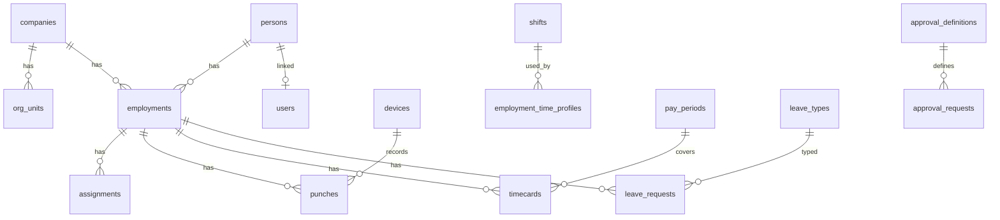

# V2_HRMIS database structure (tables + foreign keys)

Source: Laravel migrations under `database/migrations/` and `Modules/*/database/migrations/`.  
Application timezone: `Asia/Colombo`. Charset: `utf8mb4` / `utf8mb4_unicode_ci`.

## Entity relationship (core)

---

## Auth / users

### `users`
| Field | Notes |
|-------|-------|
| id | PK |
| person_id | FK → `persons.id` (nullOnDelete) |
| name | |
| email | unique |
| email_verified_at | |
| password | |
| is_active | default true |
| all_companies | default false |
| must_change_password | default true |
| remember_token | |
| created_at, updated_at | |

### `password_reset_tokens`
| Field | Notes |
|-------|-------|
| email | PK |
| token | |
| created_at | |

### `sessions`
| Field | Notes |
|-------|-------|
| id | PK |
| user_id | indexed (no FK) |
| ip_address | |
| user_agent | |
| payload | |
| last_activity | |

### `user_companies`
| Field | Notes |
|-------|-------|
| id | PK |
| user_id | FK → `users.id` (cascadeOnDelete) |
| company_id | FK → `companies.id` (restrictOnDelete) |
| | unique `(user_id, company_id)` |

### Spatie permission tables
- **`permissions`**: id, name, guard_name — unique `(name, guard_name)`
- **`roles`**: id, name, guard_name — unique `(name, guard_name)`
- **`model_has_permissions`**: permission_id → `permissions.id` (cascade), model_type, model_id
- **`model_has_roles`**: role_id → `roles.id` (cascade), model_type, model_id
- **`role_has_permissions`**: permission_id → `permissions.id` (cascade), role_id → `roles.id` (cascade)

### `audit_logs`
| Field | Notes |
|-------|-------|
| id | PK |
| user_id | FK → `users.id` (nullOnDelete) |
| company_id | indexed, no FK |
| auditable_type, auditable_id | morph |
| event | |
| old_values, new_values | json |
| reason | |
| ip | |
| created_at | |

### Framework (no business FKs)
- `cache`, `cache_locks`
- `jobs`, `job_batches`, `failed_jobs`

---

## Organisation

### `companies`
| Field | Notes |
|-------|-------|
| id | PK |
| code | unique |
| name | |
| employee_no_prefix | unique |
| employee_no_padding | default 3 |
| next_employee_seq | default 1 |
| epf_employer_no, etf_employer_no, tin | |
| is_active | default true |
| monthly_late_grace_minutes | default 240 |
| created_at, updated_at | |

### `locations`
| Field | Notes |
|-------|-------|
| id | PK |
| code | unique |
| name | |
| address | |
| is_active | |
| created_at, updated_at | |

### `org_units`
| Field | Notes |
|-------|-------|
| id | PK |
| company_id | FK → `companies.id` (restrict) |
| parent_id | FK → `org_units.id` (restrict) |
| code | unique with company_id |
| name | |
| type | |
| head_employment_id | FK → `employments.id` (nullOnDelete) |
| is_active | |
| created_at, updated_at | |

### `hr_jobs`
| Field | Notes |
|-------|-------|
| id | PK |
| code | unique |
| name | |
| name_key | unique |
| is_active | |
| created_at, updated_at | |

### `grades`
| Field | Notes |
|-------|-------|
| id | PK |
| code | unique |
| name | unique |
| rank | unique |
| is_active | |
| created_at, updated_at | |

### `employee_categories`
| Field | Notes |
|-------|-------|
| id | PK |
| code | unique |
| name | |
| name_key | unique |
| is_active | |
| annual_leaves, casual_leaves, medical_leaves | |
| normal_ot_rate, double_ot_rate | |
| no_pay_rate_per_hour, no_pay_rate_per_day | |
| saturday_rate, sunday_rate | |
| payroll_workdays, payroll_workhours | |
| saturday_ot_mode, custom_saturday_ot_type | |
| sunday_ot_mode, custom_sunday_ot_type | |
| on_duty_time, off_duty_time | |
| morning_short_beginning, morning_short_ending | |
| evening_short_beginning, evening_short_ending | |
| halfday_beginning, late_on | |
| created_at, updated_at | |

### `break_types`
| Field | Notes |
|-------|-------|
| id | PK |
| name | unique |
| is_paid | |
| remarks | |
| is_active | |
| created_at, updated_at | |

### `employee_category_breaks`
| Field | Notes |
|-------|-------|
| id | PK |
| employee_category_id | FK → `employee_categories.id` (restrict) |
| break_type_id | FK → `break_types.id` (restrict) |
| start_time, end_time | |
| duration_minutes | |
| created_at, updated_at | |
| | unique `(employee_category_id, break_type_id)` |

### `employee_category_duty_schedules`
| Field | Notes |
|-------|-------|
| id | PK |
| employee_category_id | FK → `employee_categories.id` (restrict) |
| effective_from, effective_to | unique `(employee_category_id, effective_from)` |
| on_duty_time, off_duty_time | |
| morning_short_beginning, morning_short_ending | |
| evening_short_beginning, evening_short_ending | |
| halfday_beginning, late_on | |
| created_at, updated_at | |

### `staff_work_categories`
| Field | Notes |
|-------|-------|
| id | PK |
| code | unique |
| name | |
| is_active | |
| created_at, updated_at | |

---

## CoreHr — persons

### `persons`
| Field | Notes |
|-------|-------|
| id | PK |
| nic | unique, nullable |
| nic_as_entered | |
| passport_no | unique, nullable |
| title | |
| first_name, middle_name, last_name | |
| name_with_initials, calling_name | |
| date_of_birth | |
| gender, marital_status, nationality | |
| photo_path | |
| nic_mismatch | |
| created_at, updated_at | |
| | check: nic OR passport_no not null |

### `person_contacts`
| Field | Notes |
|-------|-------|
| id | PK |
| person_id | FK → `persons.id` (cascade) |
| type, value | |
| is_primary | |
| created_at, updated_at | |

### `person_addresses`
| Field | Notes |
|-------|-------|
| id | PK |
| person_id | FK → `persons.id` (cascade) |
| type | unique with person_id |
| line1, line2, city, district, postal_code | |
| created_at, updated_at | |

### `person_emergency_contacts`
| Field | Notes |
|-------|-------|
| id | PK |
| person_id | FK → `persons.id` (cascade) |
| name, relationship, phone, address | |
| created_at, updated_at | |

### `person_dependents`
| Field | Notes |
|-------|-------|
| id | PK |
| person_id | FK → `persons.id` (cascade) |
| name, relationship, date_of_birth | |
| created_at, updated_at | |

### `person_qualifications`
| Field | Notes |
|-------|-------|
| id | PK |
| person_id | FK → `persons.id` (cascade) |
| type, institute, title, year | |
| created_at, updated_at | |

### `person_experience`
| Field | Notes |
|-------|-------|
| id | PK |
| person_id | FK → `persons.id` (cascade) |
| employer, job_title | |
| from_date, to_date | |
| created_at, updated_at | |

---

## CoreHr — employment

### `employments`
| Field | Notes |
|-------|-------|
| id | PK |
| person_id | FK → `persons.id` (restrict) |
| company_id | FK → `companies.id` (restrict) |
| employee_no | unique with company_id |
| legacy_employee_no | |
| type, status | status default ACTIVE |
| hire_date | |
| confirmation_due_date, confirmed_on | |
| epf_liable, epf_no | epf_no unique with company_id |
| exit_date, exit_reason, exit_remarks | |
| previous_employment_id | FK → `employments.id` (restrict) |
| employee_category_id | FK → `employee_categories.id` (restrict) |
| staff_work_category_id | FK → `staff_work_categories.id` (restrict) |
| active_person_id | generated; unique when ACTIVE |
| created_at, updated_at | |

### `assignments`
| Field | Notes |
|-------|-------|
| id | PK |
| employment_id | FK → `employments.id` (restrict) |
| effective_from, effective_to | unique `(employment_id, effective_from)` |
| org_unit_id | FK → `org_units.id` (restrict) |
| job_id | FK → `hr_jobs.id` (restrict) |
| grade_id | FK → `grades.id` (restrict) |
| location_id | FK → `locations.id` (restrict) |
| manager_employment_id | FK → `employments.id` (restrict) |
| change_reason | |
| created_at, updated_at | |

### `employment_events`
| Field | Notes |
|-------|-------|
| id | PK |
| employment_id | FK → `employments.id` (restrict) |
| type, event_date | |
| details | json |
| related_employment_id | FK → `employments.id` (restrict) |
| approval_request_id | FK → `approval_requests.id` (restrict) |
| created_by | FK → `users.id` (restrict) |
| created_at, updated_at | |

---

## Bank / documents

### `banks`
| Field | Notes |
|-------|-------|
| id | PK |
| code | unique |
| name | |
| is_active | |
| created_at, updated_at | |

### `bank_branches`
| Field | Notes |
|-------|-------|
| id | PK |
| bank_id | FK → `banks.id` (restrict) |
| code | unique with bank_id |
| name | |
| is_active | |
| created_at, updated_at | |

### `employee_bank_accounts`
| Field | Notes |
|-------|-------|
| id | PK |
| employment_id | FK → `employments.id` (restrict) |
| effective_from, effective_to | unique `(employment_id, effective_from)` |
| is_cash | |
| bank_id | FK → `banks.id` (restrict) |
| bank_branch_id | FK → `bank_branches.id` (restrict) |
| account_no, account_name | |
| created_at, updated_at | |

### `document_types`
| Field | Notes |
|-------|-------|
| id | PK |
| code | unique |
| name | |
| requires_expiry, is_mandatory, is_active | |
| created_at, updated_at | |

### `employee_documents`
| Field | Notes |
|-------|-------|
| id | PK |
| person_id | FK → `persons.id` (restrict) |
| employment_id | FK → `employments.id` (restrict) |
| document_type_id | FK → `document_types.id` (restrict) |
| file_path, original_name, mime_type, size_bytes | |
| issued_on, expires_on, remarks | |
| uploaded_by | FK → `users.id` (restrict) |
| archived_at | |
| created_at, updated_at | |

---

## Attendance

### `biometric_enrolments`
| Field | Notes |
|-------|-------|
| id | PK |
| employment_id | FK → `employments.id` (restrict) |
| device_group, device_user_id | |
| valid_from, valid_to | |
| created_at, updated_at | |

### `devices`
| Field | Notes |
|-------|-------|
| id | PK |
| serial_no | unique |
| name | |
| location_id | FK → `locations.id` (restrict) |
| device_group | |
| ip_address | |
| api_token_hash | |
| is_active | |
| last_seen_at | |
| created_at, updated_at | |

### `punches`
| Field | Notes |
|-------|-------|
| id | PK |
| device_id | FK → `devices.id` (restrict) |
| device_user_id | |
| punched_at | unique with device_id + device_user_id |
| employment_id | FK → `employments.id` (restrict) |
| resolution | |
| verify_mode, raw_state | |
| received_at | |

### `punch_rejections`
| Field | Notes |
|-------|-------|
| id | PK |
| device_id | FK → `devices.id` (restrict) |
| payload | json |
| reason | |
| received_at | |

### `shifts`
| Field | Notes |
|-------|-------|
| id | PK |
| code | unique |
| name | |
| start_time, end_time | |
| late_from, morning_cutoff | |
| half_day_from, early_leave_from | |
| is_active | |
| created_at, updated_at | |

### `shift_breaks`
| Field | Notes |
|-------|-------|
| id | PK |
| shift_id | FK → `shifts.id` (cascade) |
| name | |
| start_time, end_time | |
| is_paid | |
| created_at, updated_at | |

### `employment_time_profiles`
| Field | Notes |
|-------|-------|
| id | PK |
| employment_id | FK → `employments.id` (restrict) |
| effective_from, effective_to | unique `(employment_id, effective_from)` |
| shift_id | FK → `shifts.id` (restrict) |
| attendance_mode, ot_mode | |
| late_deduction | |
| created_at, updated_at | |

### `timecards`
| Field | Notes |
|-------|-------|
| id | PK |
| company_id | FK → `companies.id` (restrict) |
| employment_id | FK → `employments.id` (restrict) |
| work_date | unique with employment_id |
| pay_period_id | FK → `pay_periods.id` (restrict) |
| shift_id | FK → `shifts.id` (restrict) |
| first_in, last_out | |
| punch_count | |
| day_type, day_value | |
| short_leave | |
| late_in_minutes, early_out_minutes | |
| ot_morning_minutes, ot_evening_minutes | |
| is_holiday | |
| exception | |
| computed_at | |
| late_waived | |
| ot_approved_minutes | |
| ot_decided_by | FK → `users.id` (nullOnDelete) |
| ot_decided_at | |
| leave_type_id | FK → `leave_types.id` (nullOnDelete) |
| leave_days | |
| created_at, updated_at | |

### `attendance_adjustments`
| Field | Notes |
|-------|-------|
| id | PK |
| company_id | FK → `companies.id` (restrict) |
| employment_id | FK → `employments.id` (restrict) |
| work_date | |
| type | |
| punched_at | |
| punch_id | FK → `punches.id` (restrict) |
| reason | |
| status | |
| approval_request_id | FK → `approval_requests.id` (nullOnDelete) |
| requested_by | FK → `users.id` (restrict) |
| decided_by | FK → `users.id` (nullOnDelete) |
| decided_at | |
| created_at, updated_at | |

### `timecard_decision_logs`
| Field | Notes |
|-------|-------|
| id | PK |
| timecard_id | FK → `timecards.id` (restrict) |
| employment_id | FK → `employments.id` (restrict) |
| work_date | |
| kind | |
| old_value, new_value | |
| reason | |
| user_id | FK → `users.id` (nullOnDelete) |
| created_at | |

---

## Leave

### `leave_types`
| Field | Notes |
|-------|-------|
| id | PK |
| code | unique |
| name | |
| counts_as_credited, allows_half_day, enforce_balance | |
| requires_document, is_active | |
| created_at, updated_at | |

### `leave_policies`
| Field | Notes |
|-------|-------|
| id | PK |
| leave_type_id | FK → `leave_types.id` (restrict) |
| company_id | FK → `companies.id` (restrict) |
| grade_id | FK → `grades.id` (restrict) |
| employment_type | |
| days_per_period | |
| effective_from, effective_to | |
| created_at, updated_at | |

### `leave_requests`
| Field | Notes |
|-------|-------|
| id | PK |
| company_id | FK → `companies.id` (restrict) |
| employment_id | FK → `employments.id` (restrict) |
| leave_type_id | FK → `leave_types.id` (restrict) |
| date | |
| portion, days | |
| reason | |
| covering_employment_id | FK → `employments.id` (restrict) |
| status | |
| approval_request_id | FK → `approval_requests.id` (nullOnDelete) |
| requested_by | FK → `users.id` (restrict) |
| decided_at | |
| created_at, updated_at | |

### `leave_ledger`
| Field | Notes |
|-------|-------|
| id | PK |
| employment_id | FK → `employments.id` (restrict) |
| leave_type_id | FK → `leave_types.id` (restrict) |
| pay_period_id | FK → `pay_periods.id` (restrict) |
| kind, days | |
| leave_request_id | FK → `leave_requests.id` (nullOnDelete) |
| note | |
| created_by | FK → `users.id` (nullOnDelete) |
| created_at | |

---

## Calendar

### `holidays`
| Field | Notes |
|-------|-------|
| id | PK |
| company_id | FK → `companies.id` (restrict) |
| date | unique with company_id |
| name, kind | |
| created_at, updated_at | |

### `pay_periods`
| Field | Notes |
|-------|-------|
| id | PK |
| company_id | FK → `companies.id` (restrict) |
| year, month | unique with company_id |
| start_date, end_date | |
| status | |
| closed_at | |
| closed_by | FK → `users.id` (restrict) |
| close_version | |
| created_at, updated_at | |

### `period_expected_days`
| Field | Notes |
|-------|-------|
| id | PK |
| pay_period_id | FK → `pay_periods.id` (cascade) |
| grade_id | FK → `grades.id` (restrict) |
| days | |
| set_by | FK → `users.id` (restrict) |
| created_at, updated_at | |
| | unique `(pay_period_id, grade_id)` |

---

## Workflow

### `approval_definitions`
| Field | Notes |
|-------|-------|
| id | PK |
| code | unique |
| name | |
| is_active | |
| created_at, updated_at | |

### `approval_definition_steps`
| Field | Notes |
|-------|-------|
| id | PK |
| approval_definition_id | FK → `approval_definitions.id` (cascade) |
| sequence | unique with definition |
| approver_type, approver_ref | |
| created_at, updated_at | |

### `approval_requests`
| Field | Notes |
|-------|-------|
| id | PK |
| approval_definition_id | FK → `approval_definitions.id` (restrict) |
| company_id | FK → `companies.id` (restrict) |
| employment_id | FK → `employments.id` (nullOnDelete) |
| subject_type, subject_id | morph |
| action | |
| payload | json |
| status | default PENDING |
| current_step | |
| requested_by | FK → `users.id` (restrict) |
| requested_at, decided_at | |
| created_at, updated_at | |

### `approval_actions`
| Field | Notes |
|-------|-------|
| id | PK |
| approval_request_id | FK → `approval_requests.id` (cascade) |
| step | |
| user_id | FK → `users.id` (nullOnDelete) |
| decision, remarks | |
| acted_at | |
| created_at, updated_at | |

---

## LegacyImport

### `import_runs`
| Field | Notes |
|-------|-------|
| id | PK |
| started_at, finished_at | |
| stage | |
| summary | json |
| run_by | FK → `users.id` (restrict) |
| created_at, updated_at | |

### `stg_employees`
| Field | Notes |
|-------|-------|
| id | PK |
| import_run_id | FK → `import_runs.id` (restrict) |
| legacy_hrm_id | |
| legacy_branch_id | |
| raw | json |
| normalised_employee_no, normalised_nic | |
| company_code | |
| loaded_employment_id | no FK |
| load_error | |
| created_at, updated_at | |

### `stg_issues`
| Field | Notes |
|-------|-------|
| id | PK |
| import_run_id | FK → `import_runs.id` (restrict) |
| legacy_hrm_id | |
| code, severity, message | |
| created_at, updated_at | |

### `legacy_sync_runs`
| Field | Notes |
|-------|-------|
| id | PK |
| company_id | FK → `companies.id` (restrict) |
| from_at, to_at | |
| file_path | |
| new_hires, exits, changes | |
| applied_by | FK → `users.id` (restrict) |
| applied_at | |
| created_at | |

---

## Foreign key index (quick reference)

| From table.column | → To table.column | On delete |
|-------------------|-------------------|-----------|
| users.person_id | persons.id | null |
| user_companies.user_id | users.id | cascade |
| user_companies.company_id | companies.id | restrict |
| audit_logs.user_id | users.id | null |
| org_units.company_id | companies.id | restrict |
| org_units.parent_id | org_units.id | restrict |
| org_units.head_employment_id | employments.id | null |
| employee_category_breaks.employee_category_id | employee_categories.id | restrict |
| employee_category_breaks.break_type_id | break_types.id | restrict |
| employee_category_duty_schedules.employee_category_id | employee_categories.id | restrict |
| person_*.person_id | persons.id | cascade |
| employments.person_id | persons.id | restrict |
| employments.company_id | companies.id | restrict |
| employments.previous_employment_id | employments.id | restrict |
| employments.employee_category_id | employee_categories.id | restrict |
| employments.staff_work_category_id | staff_work_categories.id | restrict |
| assignments.employment_id | employments.id | restrict |
| assignments.org_unit_id | org_units.id | restrict |
| assignments.job_id | hr_jobs.id | restrict |
| assignments.grade_id | grades.id | restrict |
| assignments.location_id | locations.id | restrict |
| assignments.manager_employment_id | employments.id | restrict |
| employment_events.employment_id | employments.id | restrict |
| employment_events.related_employment_id | employments.id | restrict |
| employment_events.approval_request_id | approval_requests.id | restrict |
| employment_events.created_by | users.id | restrict |
| bank_branches.bank_id | banks.id | restrict |
| employee_bank_accounts.employment_id | employments.id | restrict |
| employee_bank_accounts.bank_id | banks.id | restrict |
| employee_bank_accounts.bank_branch_id | bank_branches.id | restrict |
| employee_documents.person_id | persons.id | restrict |
| employee_documents.employment_id | employments.id | restrict |
| employee_documents.document_type_id | document_types.id | restrict |
| employee_documents.uploaded_by | users.id | restrict |
| biometric_enrolments.employment_id | employments.id | restrict |
| devices.location_id | locations.id | restrict |
| punches.device_id | devices.id | restrict |
| punches.employment_id | employments.id | restrict |
| punch_rejections.device_id | devices.id | restrict |
| shift_breaks.shift_id | shifts.id | cascade |
| employment_time_profiles.employment_id | employments.id | restrict |
| employment_time_profiles.shift_id | shifts.id | restrict |
| timecards.company_id | companies.id | restrict |
| timecards.employment_id | employments.id | restrict |
| timecards.pay_period_id | pay_periods.id | restrict |
| timecards.shift_id | shifts.id | restrict |
| timecards.ot_decided_by | users.id | null |
| timecards.leave_type_id | leave_types.id | null |
| attendance_adjustments.company_id | companies.id | restrict |
| attendance_adjustments.employment_id | employments.id | restrict |
| attendance_adjustments.punch_id | punches.id | restrict |
| attendance_adjustments.approval_request_id | approval_requests.id | null |
| attendance_adjustments.requested_by | users.id | restrict |
| attendance_adjustments.decided_by | users.id | null |
| timecard_decision_logs.timecard_id | timecards.id | restrict |
| timecard_decision_logs.employment_id | employments.id | restrict |
| timecard_decision_logs.user_id | users.id | null |
| leave_policies.leave_type_id | leave_types.id | restrict |
| leave_policies.company_id | companies.id | restrict |
| leave_policies.grade_id | grades.id | restrict |
| leave_requests.company_id | companies.id | restrict |
| leave_requests.employment_id | employments.id | restrict |
| leave_requests.leave_type_id | leave_types.id | restrict |
| leave_requests.covering_employment_id | employments.id | restrict |
| leave_requests.approval_request_id | approval_requests.id | null |
| leave_requests.requested_by | users.id | restrict |
| leave_ledger.employment_id | employments.id | restrict |
| leave_ledger.leave_type_id | leave_types.id | restrict |
| leave_ledger.pay_period_id | pay_periods.id | restrict |
| leave_ledger.leave_request_id | leave_requests.id | null |
| leave_ledger.created_by | users.id | null |
| holidays.company_id | companies.id | restrict |
| pay_periods.company_id | companies.id | restrict |
| pay_periods.closed_by | users.id | restrict |
| period_expected_days.pay_period_id | pay_periods.id | cascade |
| period_expected_days.grade_id | grades.id | restrict |
| period_expected_days.set_by | users.id | restrict |
| approval_definition_steps.approval_definition_id | approval_definitions.id | cascade |
| approval_requests.approval_definition_id | approval_definitions.id | restrict |
| approval_requests.company_id | companies.id | restrict |
| approval_requests.employment_id | employments.id | null |
| approval_requests.requested_by | users.id | restrict |
| approval_actions.approval_request_id | approval_requests.id | cascade |
| approval_actions.user_id | users.id | null |
| import_runs.run_by | users.id | restrict |
| stg_employees.import_run_id | import_runs.id | restrict |
| stg_issues.import_run_id | import_runs.id | restrict |
| legacy_sync_runs.company_id | companies.id | restrict |
| legacy_sync_runs.applied_by | users.id | restrict |
